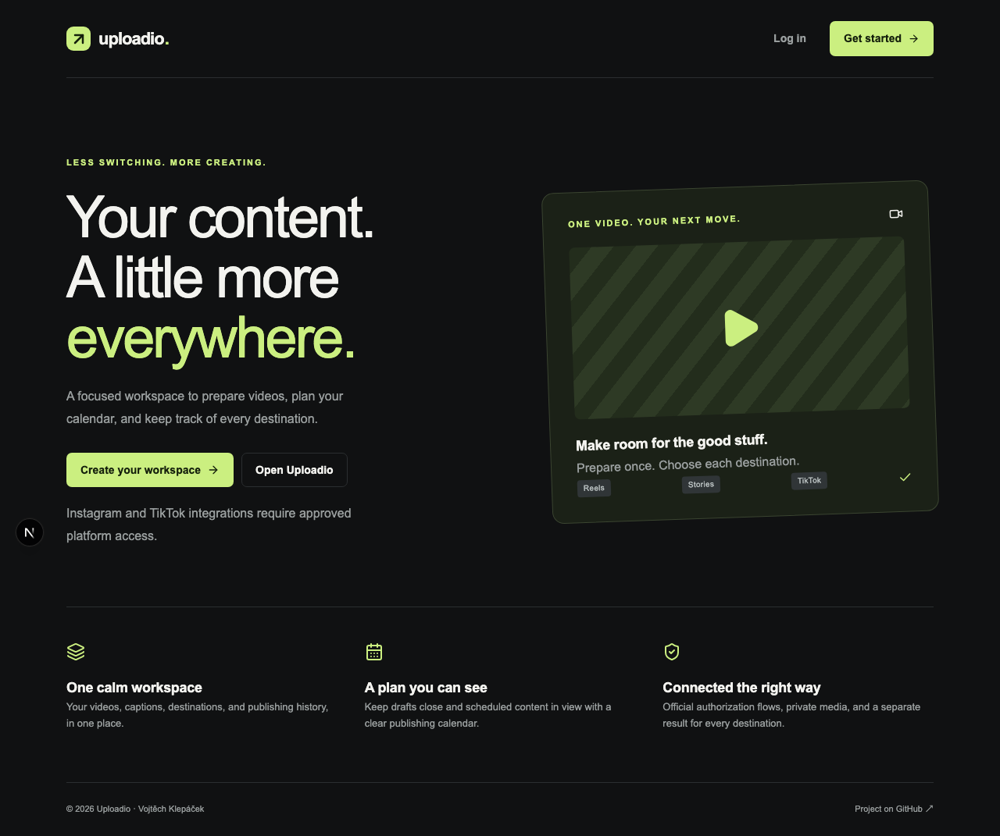

# Uploadio

A social media publishing workspace for creators and businesses. Prepare a video, customize each destination, publish or schedule it, and track each result independently.

Owned and maintained by **Vojtěch Klepáček** — [@klepacek](https://github.com/klepacek).

## Current functionality

- Supabase email/password authentication, email confirmation, password recovery, logout and profile preferences.
- Personal workspaces backed by membership authorization.
- Private R2 uploads, quota reservations, FFmpeg inspection, thumbnails and media deletion.
- Instagram Login, encrypted tokens, token refresh, Reels and eligible business-account Stories.
- TikTok OAuth, rotating refresh tokens, creator information, inbox uploads and approval-gated Direct Post.
- Shared and per-account captions, consent, drafts, immediate dispatch and UTC scheduling.
- Persistent publishing targets, atomic worker claims, bounded retries, interrupted-job recovery and provider reconciliation.
- Dashboard, composer, drafts, scheduled posts, monthly/weekly calendar, accounts, media library, settings and per-destination history.
- Docker services, Alembic migrations, automated tests, lint, formatting, type checks and GitHub Actions.

**Release status:** implemented application paths are tested with mocked platform responses. Real OAuth, R2 uploads, Supabase email delivery and publication have not been verified without credentials. This repository is not yet certified for public commercial deployment. Read the [integration requirements](docs/integrations.md) and [release gate](docs/deployment.md#release-gate).

## Stack

Python 3.12+, FastAPI, Pydantic v2, SQLAlchemy 2, Alembic, PostgreSQL, Redis, Celery, HTTPX, FFmpeg, Pytest, Ruff and mypy. The frontend uses Next.js App Router, TypeScript, Tailwind CSS, shadcn-style UI components, Radix, Lucide, TanStack Query, React Hook Form and Zod. Infrastructure uses Supabase Auth, Cloudflare R2, Docker Compose and GitHub Actions. Sentry is optional.

## Quick start

Install Docker and Compose, then:

```sh
git clone https://github.com/klepacek/Uploadio.git
cd Uploadio
cp .env.example .env
```

Set Supabase, R2 and encryption configuration in `.env`. Public Next.js variables must be set before building. Social credentials can be added later; connection endpoints report missing configuration rather than simulating success.

```sh
docker compose up --build
```

Open [Uploadio](http://localhost:3000) and [API documentation](http://localhost:8000/docs). Full native setup, environment variables, callback URLs, R2 CORS and deployment instructions are in [docs/deployment.md](docs/deployment.md).

## Screenshots



## Development checks

```sh
cd backend
.venv/bin/ruff check .
.venv/bin/ruff format --check .
.venv/bin/mypy app
.venv/bin/pytest
.venv/bin/alembic check
```

`alembic check` needs a migrated PostgreSQL database. Standard tests do not need social credentials. FFmpeg and PostgreSQL concurrency tests run when their dependencies are available; set `POSTGRES_TEST_URL` to a disposable database for the latter. The PostgreSQL test creates and removes an isolated schema.

```sh
cd frontend
npm ci
npm run lint
npm run format:check
npm run typecheck
npm test
npm run build
npx playwright install chromium
npm run test:e2e
```

The frontend uses the Webpack production builder. The local Turbopack CSS pipeline encountered a host process restriction; Webpack builds passed.

## Integration requirements

Instagram publishing requires a professional account, approved permissions and a configured Meta app. Stories are limited to eligible business accounts. TikTok inbox uploads require the creator to finish in TikTok and are shown as `draft_uploaded`, never as published. Direct Post requires appropriate TikTok approval, explicit consent and current creator privacy settings. Unaudited restrictions remain enforced by TikTok. TikTok Stories are not supported.

See [official API references and live verification requirements](docs/integrations.md).

## Known limits

- Live credentials and platform approval were unavailable during implementation.
- No invitation or member-management UI; the schema supports membership.
- Uncertain publishing outcomes require operator review. There is no operator resolution UI yet.
- TikTok inbox monitoring ends after inbox delivery. Public links are only shown when a provider supplies a usable link; a basic TikTok profile response does not provide a verified username/share URL.
- Lists show at most the latest 50 posts in the interface; the API supports pagination. The calendar caps a query at 500 posts.
- Media inspection is synchronous within the API request. No automatic transcoding is performed, and final platform format validation remains authoritative.
- Source quotas exclude thumbnail and temporary-object overhead. Configure staging lifecycle cleanup.
- Browser authentication stores the Supabase session in the browser. Add a reviewed CSP and complete browser security testing before commercial release.
- Desktop/mobile browser tests cover public navigation, registration validation, signed-out protection, and an empty workspace with test API responses. Live authenticated workflows still need verification in a configured environment.
- The local host lacked Docker, PostgreSQL, Redis and FFmpeg. PostgreSQL concurrency, FFmpeg processing, migrations and image builds passed in GitHub CI. The Compose startup smoke check runs there as well.
- Development lint dependencies currently report a moderate `minimatch` advisory. The production frontend dependency audit was clean. Review the development dependency chain before processing untrusted repositories.

## Documentation

- [Setup and deployment](docs/deployment.md)
- [Architecture and failure handling](docs/architecture.md)
- [Platform integrations](docs/integrations.md)

Copyright © 2026 Vojtěch Klepáček. All rights reserved; see [LICENSE](LICENSE). Third-party packages retain their own licenses.
